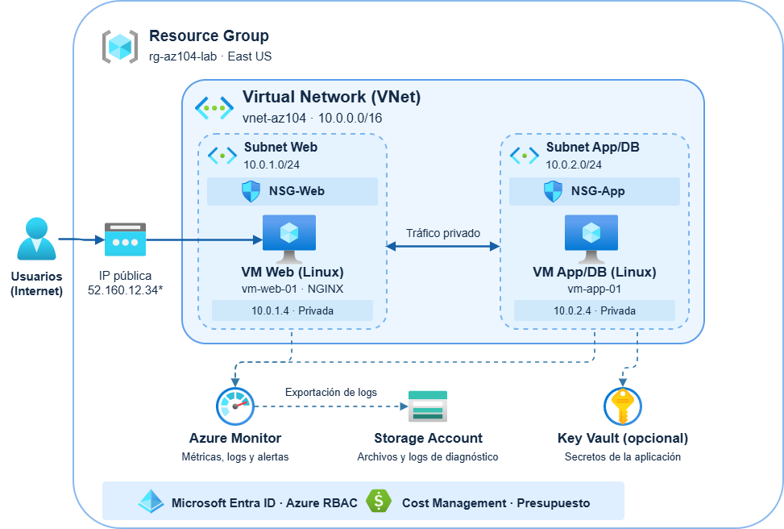

# Azure Secure Infrastructure Lab

## Project Overview

This hands-on project builds a segmented Azure environment for a public Linux web server and a private Linux workload. It demonstrates Azure administration skills through documented configuration, security decisions, connectivity tests, and cost management while preparing for the **Microsoft Azure Administrator (AZ-104)** certification.

The lab uses **Azure for Students**. The current evidence covers subscription review, resource group creation, resource tags, and budget configuration. Networking, virtual machines, and monitoring are the next implementation stages.

## Project Objectives

- Design and implement a secure Azure cloud infrastructure.
- Configure resource groups, virtual networks, and subnets.
- Deploy and manage Linux virtual machines.
- Implement network security using Network Security Groups (NSGs).
- Apply Azure Role-Based Access Control (RBAC).
- Monitor infrastructure using Azure Monitor.
- Manage cloud resources and optimize costs.
- Document the deployment process and technical decisions.

## Planned Architecture

*Target architecture for the lab. The diagram includes planned resources and optional extensions; implementation progress is tracked below. IP addresses shown in the diagram are illustrative.*

### Traffic Flow and Security Design

1. **Public web access:** Internet users reach the public IP associated with the Linux web VM running Nginx. The web subnet NSG will allow HTTP on port 80 for the demonstration and restrict SSH on port 22 to the administrator's public IP (`/32`).
2. **Network segmentation:** `vnet-az104` separates the web workload (`10.0.1.0/24`) from the private workload (`10.0.2.0/24`). Each subnet will have its own NSG to control inbound traffic.
3. **Private workload access:** The internal Linux VM will have no public IP. The lab will test an explicit SSH exception from the web subnet and a deny rule for other traffic from that subnet, demonstrating both permitted and blocked connections.
4. **Operations and governance:** Azure Monitor is planned for metrics and alerts. Resource organization, access management, and spending visibility are addressed through the resource group, Azure RBAC, and Cost Management.

The diagram labels the internal tier as **App/DB**; the core exercise uses a temporary private Linux VM for connectivity tests. Storage-based log export and Key Vault are optional extensions shown in the diagram.

### Core Configuration

| Resource | Configuration |
|---|---|
| Resource Group | `rg-az104-lab` |
| Virtual Network | `vnet-az104` |
| VNet Address Space | `10.0.0.0/16` |
| Web Subnet | `10.0.1.0/24` |
| Private Subnet | `10.0.2.0/24` |
| Operating System | Ubuntu Server 24.04 LTS |
| Cloud Provider | Microsoft Azure |

The planned security tests will verify public HTTP access, restricted administrative access, and the NSG rules between the two subnets.

## Project Roadmap

| Week | Focus Area | Status |
|---|---|---|
| Week 1 | Resource Governance & Azure Setup | In Progress |
| Week 2 | Virtual Networking & Security | Planned |
| Week 3 | Virtual Machines & Connectivity | Planned |
| Week 4 | Monitoring, Cost Management & Documentation | Planned |

---

## Week 1 — Azure Resource Governance & Initial Setup

### Objective

Establish the foundation of the Azure infrastructure by organizing cloud resources, understanding access control, and implementing basic cost management practices.

### Implementation Progress

| Activity | Result | Evidence |
|---|---|---|
| Subscription review | Confirmed an active Azure for Students subscription and the current user's Owner role | [Subscription overview](screenshots/1.1-subscription.png) |
| Resource group | Created `rg-az104-lab` as the management scope for the project | [Resource group and tags](screenshots/1.3.1-resource-group-tags.png) |
| Resource tagging | Applied `project=az104-lab`, `environment=lab`, and `owner=student` | [Saved tags](screenshots/1.3.1-resource-group-tags.png) |
| Budget configuration | Captured `budget-az104-lab` with a monthly amount of USD 10 | [Budget configuration](screenshots/1.3.2-budget-configuration.png) |
| Alert configuration | Captured actual-cost thresholds at 50%, 80%, and 100% (USD 5, 8, and 10) | [Alert configuration](screenshots/1.3.3-budget-alerts.png) |

The budget screenshots show configuration settings; notification delivery has not yet been documented. The budget supports spending awareness and does not enforce a spending cap.

The current user's Owner role is recorded as part of the subscription review. Custom RBAC assignments and access tests have not yet been documented.

### Technical Decisions

| Decision | Justification |
|---|---|
| Single Resource Group | Simplifies resource organization and cleanup |
| Resource Tags | Improves resource tracking and cost visibility |
| Azure RBAC | Supports controlled access to resources |
| Budget Alerts | Provides spending thresholds for reviewing credit consumption |
| Small VM Sizes | Reduces infrastructure costs during testing |

### Detailed Documentation

[Week 1: Resource Governance and Initial Setup](docs/week-01-governance.md) explains the subscription review, resource group, and tags with embedded screenshots. Budget and alert documentation will be added in the next update.

---

## Technologies

- Microsoft Azure
- Azure Resource Manager
- Microsoft Entra ID
- Azure RBAC
- Azure Cost Management
- Azure Virtual Network (planned)
- Azure Virtual Machines (planned)
- Azure Monitor (planned)
- Git & GitHub

## Learning Outcomes

This project is intended to strengthen practical knowledge of Azure administration, including:

- Resource organization and governance
- Cloud infrastructure management
- Identity and access control
- Network security
- Monitoring and cost optimization

## References

- [Microsoft Learn — AZ-104](https://learn.microsoft.com/en-us/credentials/certifications/azure-administrator/)
- [Azure Resource Groups](https://learn.microsoft.com/en-us/azure/azure-resource-manager/management/manage-resource-groups-portal)
- [Azure RBAC](https://learn.microsoft.com/en-us/azure/role-based-access-control/overview)
- [Azure Cost Management](https://learn.microsoft.com/en-us/azure/cost-management-billing/)

---

**Project Status:** In Progress

*This is a personal hands-on learning project developed as part of my preparation for the Microsoft Azure Administrator (AZ-104) certification.*
