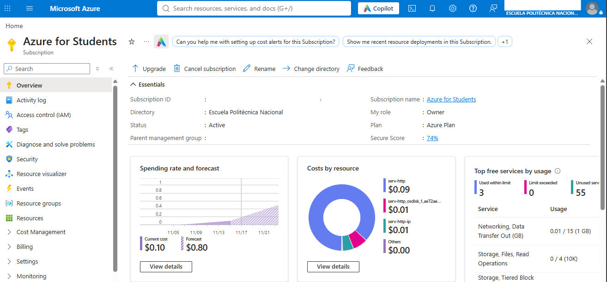
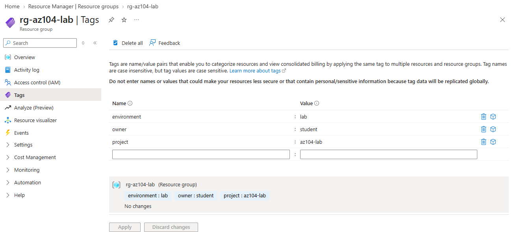

# Week 1 - Azure Resource Governance and Initial Setup

## Objective

Establish the governance foundation for the Azure Secure Infrastructure Lab by reviewing the subscription, creating a dedicated resource group, and applying resource tags before deploying the network and virtual machines.

## 1. Subscription Review

The Azure Portal subscription overview was reviewed to confirm that the lab uses an active **Azure for Students** subscription. The overview also shows the current user's **Owner** role at the subscription scope.

| Item | Observed value |
|---|---|
| Subscription | Azure for Students |
| Status | Active |
| Current user role | Owner |

This review establishes the subscription context for the lab. The screenshot records the subscription status and assigned role; regional availability, VM quotas, and remaining student credits still require separate checks before deploying compute resources.

*Evidence: subscription overview in the Azure Portal, with the subscription ID hidden.*

## 2. Dedicated Resource Group

The resource group **`rg-az104-lab`** was created to organize the resources belonging to this project. Its existence is confirmed by the resource group Tags page shown in the next section.

A dedicated resource group provides a common management scope for the lab and makes it easier to review its resources, manage access, and clean up the environment when the exercises are complete.

| Setting | Value |
|---|---|
| Resource group name | `rg-az104-lab` |
| Purpose | Organize and manage the Azure lab resources |
| Management interface | Azure Portal |

## 3. Resource Tags

The following tags were applied to `rg-az104-lab` to identify the project, environment, and responsible owner:

| Tag | Value | Purpose |
|---|---|---|
| `project` | `az104-lab` | Identify the project associated with the resource group |
| `environment` | `lab` | Identify the environment as a learning lab |
| `owner` | `student` | Record responsibility for the lab |

These tags provide consistent metadata for organizing and reviewing the environment. The evidence below confirms the three saved tags on the resource group.

*Evidence: resource group Tags page showing the configured names and values.*
