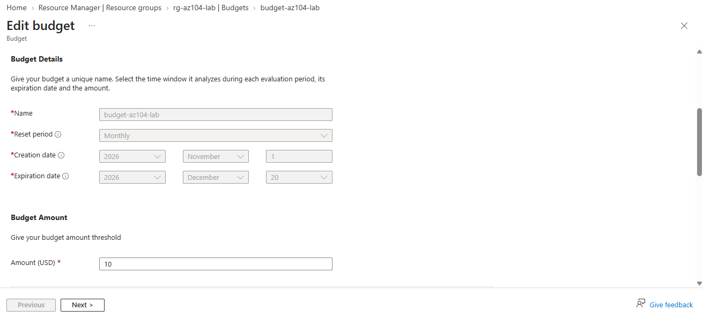
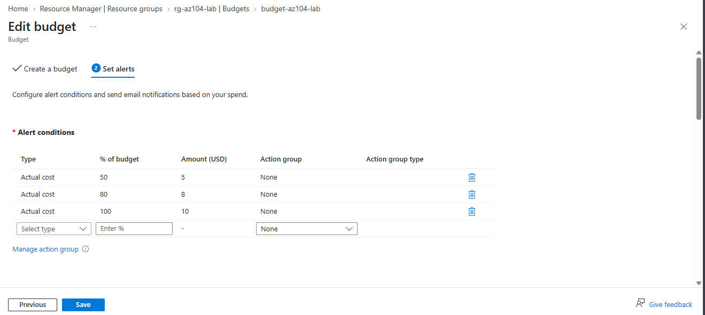

# Week 1 - Azure Resource Governance and Initial Setup

## Objective

Establish a manageable Azure lab environment with a dedicated resource group, clear ownership tags, and spending visibility before deploying the network and virtual machines.

**Scope:** subscription review, resource organization, tagging, and budget configuration using the Azure Portal.

## 1. Subscription Review

Reviewed the subscription overview and confirmed an active **Azure for Students** subscription. The current user's **Owner** role was recorded to understand the administrative access available for the lab.

| Item | Observed value |
|---|---|
| Subscription | Azure for Students |
| Status | Active |
| Current user role | Owner |

This establishes the subscription context for subsequent deployments. VM quotas, regional availability, and remaining student credits require separate checks before creating compute resources.

## 2. Dedicated Resource Group

Created **`rg-az104-lab`** as the management scope for the project. Keeping the lab resources together simplifies inventory, access management, cost review, and cleanup after testing.

The Tags screenshot below confirms the resource group and its saved metadata.

## 3. Resource Tags

Applied three tags to make the resource group's purpose and ownership easy to identify:

| Tag | Value | Purpose |
|---|---|---|
| `project` | `az104-lab` | Identify the project associated with the resource group |
| `environment` | `lab` | Identify the environment as a learning lab |
| `owner` | `student` | Record responsibility for the lab |

## 4. Monthly Budget

Configured **`budget-az104-lab`** at the `rg-az104-lab` scope with a **USD 10 monthly budget**. This provides a reference for reviewing spending as resources are added to the lab.

| Setting | Configuration |
|---|---|
| Budget name | `budget-az104-lab` |
| Scope | `rg-az104-lab` |
| Reset period | Monthly |
| Amount | USD 10 |
| Validity shown | November 1 - December 20, 2026 |

## 5. Spending Alert Thresholds

Set three **actual-cost** thresholds to flag increasing consumption of the monthly budget:

| Threshold | Cost | Purpose |
|---|---|---|
| 50% | USD 5 | Review usage early |
| 80% | USD 8 | Check running resources and remaining exercises |
| 100% | USD 10 | Review spending and decide which resources to stop or remove |

The screenshots document the budget and alert settings. Notification delivery has not been verified. **The budget does not cap spending or automatically stop resources.** Its validity must also be reviewed if the lab continues beyond December 20, 2026.

## Results and Skills Demonstrated

| Result | Skill demonstrated |
|---|---|
| Subscription status and current role reviewed | Subscription and access awareness |
| Dedicated resource group created | Resource organization and lifecycle planning |
| Project, environment, and owner tags applied | Consistent governance metadata |
| Monthly budget and cost thresholds documented | Cost management and spending awareness |

The Owner role shown is an existing assignment; this phase does not demonstrate custom RBAC configuration. The next phase focuses on the VNet, subnets, and NSG rules.

[Back to project overview](../README.md)
