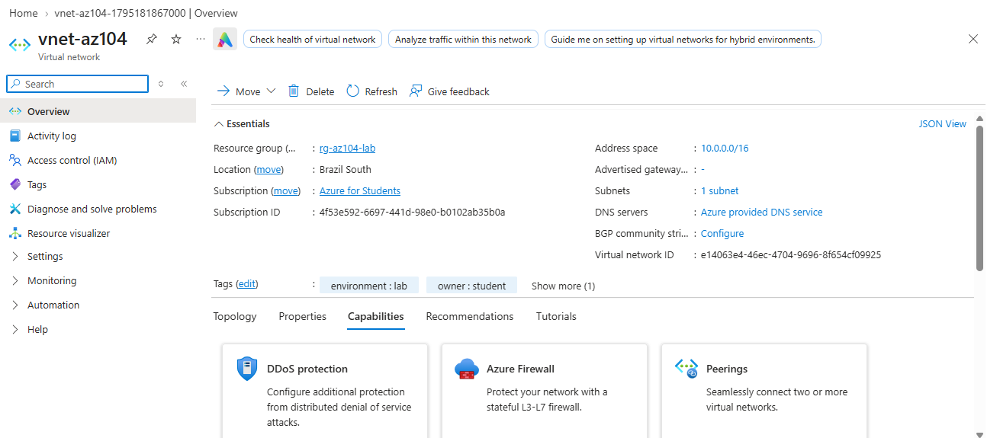
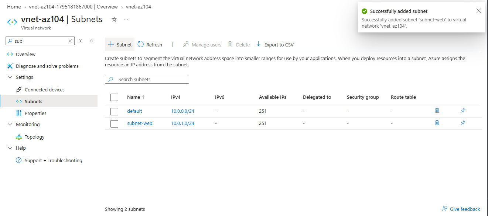
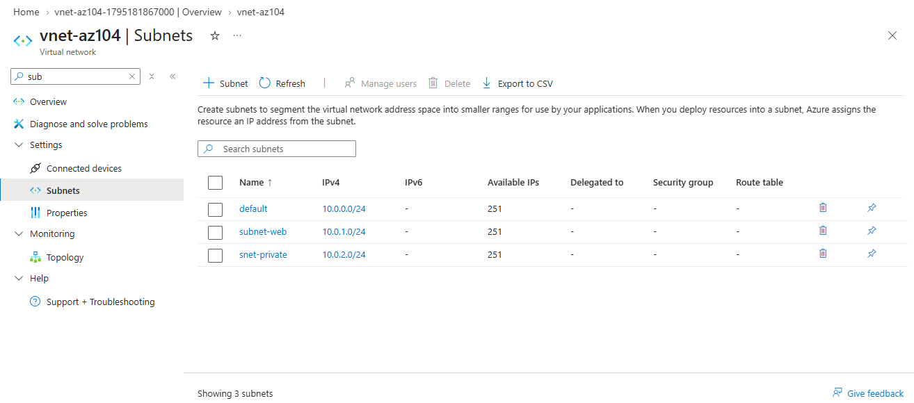
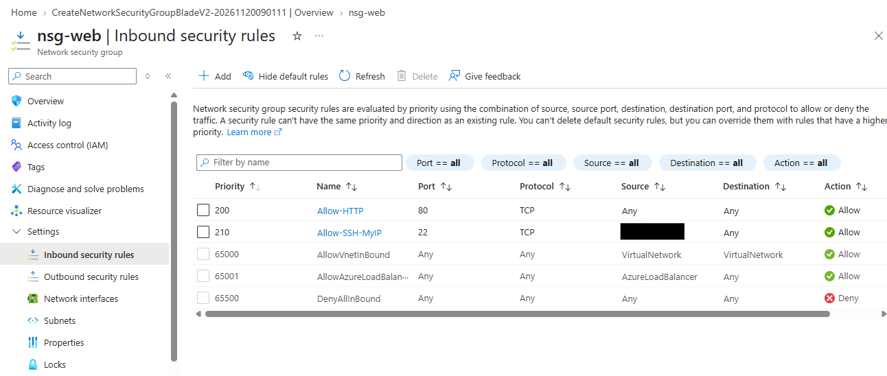
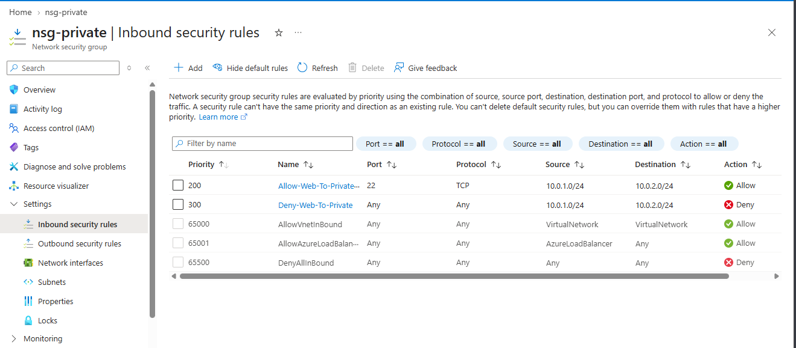

# Week 2 - Virtual Networking and Security

## Objective

Build the network foundation for a public web workload and a private application/database workload. Separate subnets provide the structure for applying different network security policies.

**Scope:** virtual network, IP address planning, subnet creation, and the initial NSG policies. Workload connectivity tests and the PostgreSQL exception belong to Week 3.

## 1. Virtual Network

Created **`vnet-az104`** in **`rg-az104-lab`** with the address space **`10.0.0.0/16`**. The current overview shows the VNet in **North Central US**, under the Azure for Students subscription.

The address range accommodates separate workload subnets and leaves room for additional network segments as the lab grows.

## 2. Web Subnet

Created the web subnet with **`10.0.1.0/24`** for the Linux web VM. In the expanded application design, this VM hosts Nginx and the Flask/Gunicorn application that connects to PostgreSQL over the private network.

The creation screenshot records the subnet as **`subnet-web`**. Keeping the web tier in its own subnet provides a separate scope for its HTTP and administrative access rules.

## 3. Private Subnet

Created **`snet-private`** with **`10.0.2.0/24`** for the internal Linux VM, which now hosts PostgreSQL. The intended design keeps that VM without a public IP and permits database access from the web VM through an explicit NSG rule.

| Subnet shown in the creation evidence | Address range | Role |
|---|---|---|
| `default` | `10.0.0.0/24` | Default subnet present in the VNet |
| `subnet-web` | `10.0.1.0/24` | Web and application tier |
| `snet-private` | `10.0.2.0/24` | Private PostgreSQL tier |

The subnet screenshots capture the initial configuration, before NSG associations were visible. **Separate subnets alone do not enforce traffic isolation**; the following NSG rules define which connections are allowed or denied when applied to the workloads.

## 4. Web Network Security Group

Configured **`nsg-web`** with two custom inbound rules:

| Priority | Rule | Source | Destination | Protocol / port | Action |
|---|---|---|---|---|---|
| 200 | `Allow-HTTP` | Any | Any | TCP 80 | Allow |
| 210 | `Allow-SSH-MyIP` | Administrator's public IP | Any | TCP 22 | Allow |

HTTP supports the public Nginx demonstration. The SSH rule restricts administrative access to the configured source IP; the intended source is a single public address with a `/32` prefix. That address is hidden in the screenshot.

## 5. Private Network Security Group

Configured **`nsg-private`** with an SSH exception followed by an explicit deny rule for other traffic from the web subnet:

| Priority | Rule | Source | Destination | Protocol / port | Action |
|---|---|---|---|---|---|
| 200 | `Allow-Web-To-Private-SSH` | `10.0.1.0/24` | `10.0.2.0/24` | TCP 22 | Allow |
| 300 | `Deny-Web-To-Private` | `10.0.1.0/24` | `10.0.2.0/24` | Any | Deny |

The lower numerical priority is evaluated first, so SSH matches the exception before the broader deny. This establishes a controlled administrative path between the two workload subnets.

This screenshot records the initial policy. Week 3 extends it with a specific PostgreSQL exception for the application, while retaining the broader deny.

## 6. Default Rules and Policy Limits

Both NSG screenshots show the default inbound rules:

| Priority | Default rule | Action |
|---|---|---|
| 65000 | `AllowVNetInBound` | Allow traffic matching the VirtualNetwork service tag |
| 65001 | `AllowAzureLoadBalancerInBound` | Allow traffic matching the AzureLoadBalancer service tag |
| 65500 | `DenyAllInBound` | Deny remaining inbound traffic |

The custom deny at priority 300 takes precedence over the default VNet allow for traffic from the web subnet to the private subnet. Its scope is that specific path; it does not deny every possible source within the VNet.

The intended associations are `nsg-web` to the web subnet and `nsg-private` to `snet-private`. The Week 2 screenshots show the rule definitions, but do not independently confirm those associations. Rule configuration and successful traffic filtering must be assessed separately; the workload tests are part of Week 3.

## Results and Skills Demonstrated

| Documented result | Skill demonstrated |
|---|---|
| VNet with non-overlapping workload subnets | IP planning and network segmentation |
| HTTP and source-restricted SSH rules | Public access and administrative access design |
| Private SSH exception and explicit deny | Traffic filtering with rule priorities |
| Default rules and evidence limits explained | Configuration review and security reasoning |

The Week 2 network design and initial NSG policies are documented. Week 3 covers the deployed workloads, database access, and positive and negative connectivity tests.

[Back to project overview](../README.md)
